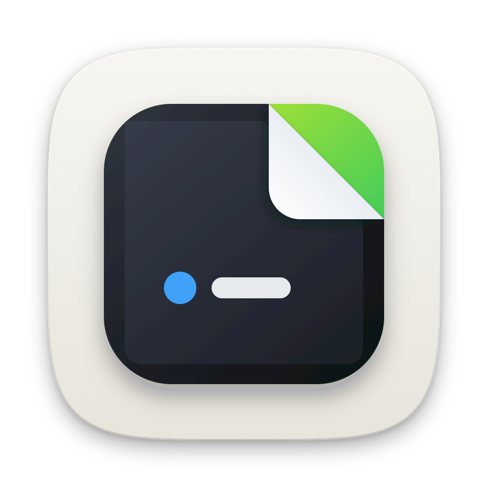
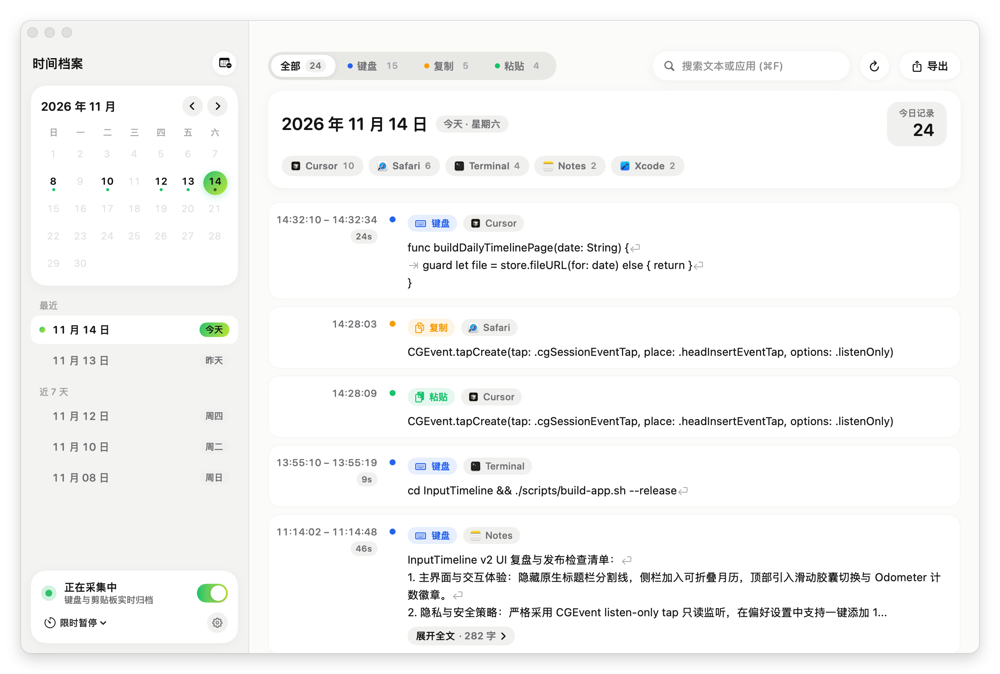
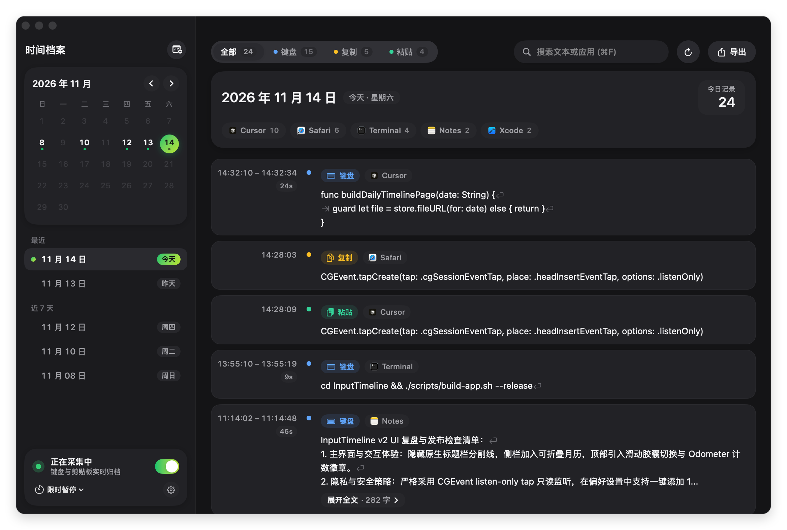
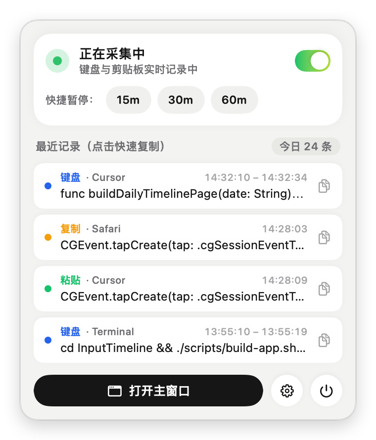
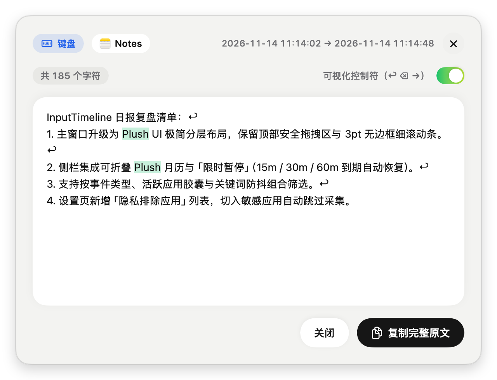
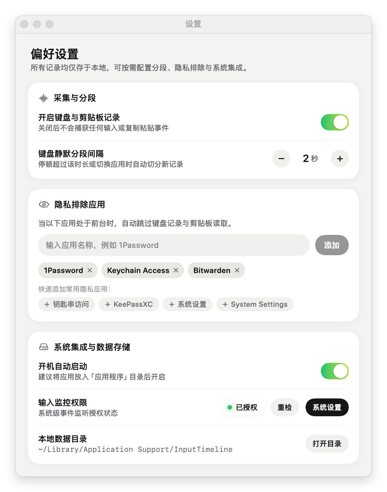
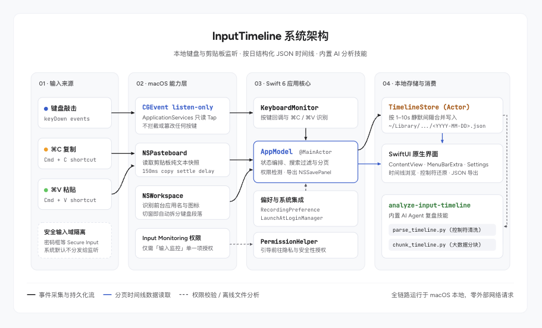

<div align="center">



# InputTimeline

**macOS 原生本地输入记录工具 — 只读监听键盘与剪贴板，采用全新 Plush UI 呈现每日输入时间线并沉淀为结构化 JSON。**

[](https://lxx-003.github.io/input-time-line/)
[](https://www.apple.com/macos/)
[](https://swift.org/)
[](LICENSE)

[访问项目官网](https://lxx-003.github.io/input-time-line/) &nbsp;&middot;&nbsp; [界面预览](#界面预览) &nbsp;&middot;&nbsp; [核心特性](#核心特性) &nbsp;&middot;&nbsp; [系统架构](#系统架构) &nbsp;&middot;&nbsp; [快速开始](#快速开始) &nbsp;&middot;&nbsp; [AI 复盘技能](#ai-复盘技能analyze-input-timeline)

<sub>Swift 6 + SwiftUI + AppKit 原生构建 &nbsp;&middot;&nbsp; 浅色 / 深色外观自适应 &nbsp;&middot;&nbsp; 100% 本地离线存储 · 零网络请求</sub>

</div>

---

> [!IMPORTANT]
> **隐私与权限原则**：InputTimeline 仅通过 `ApplicationServices` 的 **`CGEvent` listen-only tap**（只读监听）接收按键事件，不拦截也不修改任何输入；支持在设置中配置「隐私排除应用」，切入敏感应用时自动跳过键盘与剪贴板采集；系统密码框等安全输入域（Secure Input）在开启期间不会被系统分发给监听端。所有记录仅保存在本机 `~/Library/Application Support/InputTimeline/`，不发起任何网络请求。

---

## 界面预览

<sub>以下截图均采用内置脱敏预览数据于 macOS 原生编译渲染：</sub>

<div align="center">
  
</div>

<details>
<summary>查看深色模式、菜单栏弹出、偏好设置与全文检视弹窗截图</summary>

<br />

**主时间线窗口（深色模式）**
<div align="center">
  
</div>

<br />

| 菜单栏卡片弹窗 (`MenuBarExtra`) | 全文检视弹窗 (`TimelineDetailSheet`) |
| :---: | :---: |
|  |  |

<br />

**偏好设置 (`SettingsView`)**
<div align="center">
  
</div>

</details>

---

## 核心特性

### 采集与隐私防护
- [x] **键盘静默自动分段** — 捕获连续按键并按静默间隔合并为完整输入段，间隔可在设置中按 `1–10 秒` 调节（默认 `2 秒`）
- [x] **前台应用感知** — 通过 `NSWorkspace` 读取当前应用名称与真实图标，切换前台窗口时自动拆分为新段落
- [x] **剪贴板流转与来源识别** — 识别 `⌘C` 复制与 `⌘V` 粘贴快捷键，记录剪贴板纯文本快照及所属应用名称
- [x] **隐私排除应用列表** — 支持自定义或一键添加 `1Password`、`钥匙串访问`、`Bitwarden`、`KeePassXC` 等敏感应用，切入前台即跳过记录

### Plush UI 原生交互体验
- [x] **无割裂隐藏标题栏与细滚动条** — 移除原生雾化标题栏分割线，保留顶部安全拖拽区与 `3pt` 无边框细滑块，动态适配系统浅色 / 深色模式
- [x] **可折叠 Plush 月历与日期归档** — 侧栏集成按月切换的小日历（绿点标注有记录日期），列表按「最近 / 近 7 天 / 更早记录」自动分组
- [x] **三维联动筛选与高亮** — 支持 `全部 / 键盘 / 复制 / 粘贴` 滑动胶囊切换（`⌘1`–`⌘4`）、活跃应用胶囊点击筛选与关键词防抖检索高亮（`⌘F`）
- [x] **控制字符可视化与 Toast 反馈** — 超长记录展示「展开全文」胶囊并支持弹窗切换 `\b→⌫`、`\r→↩`、`\n→↵`、`\t→→`、`ESC→⎋`，复制/刷新/导出均提供右下角 Sonner Toast 提示
- [x] **MenuBarExtra 卡片弹窗与限时暂停** — 菜单栏直接展示采集状态、`15m / 30m / 60m` 快捷限时暂停（到期自动恢复）及最近 4 条记录点击即复制；支持开机自启（默认开启）

### 开放数据与 AI 协作
- [x] **按日结构化 JSON 落盘** — 每日独立 JSON 文件，流式分页解码，支持一键呼出系统 `NSSavePanel` 导出备份
- [x] **内置 `analyze-input-timeline` 技能** — 仓库自带解析与分块脚本，可直接让 AI Agent 总结你任意一天的输入轨迹与工作模式

---

## 系统架构



<details>
<summary>查看技术栈与模块职责</summary>

| 层级 | 组件 / API | 职责说明 |
|------|-----------|----------|
| 系统能力层 | `CGEvent` listen-only tap | 只读监听全局 `keyDown` 与 `⌘C` / `⌘V`，无需辅助功能拦截权限 |
| 系统能力层 | `NSWorkspace` / `NSPasteboard` | 获取前台应用名与图标缓存（`AppIconProvider`）、读取剪贴板纯文本 |
| 状态与查询 | `AppModel` / `TimelineQueryEngine` | 事件回调分发、三维过滤、流式分页解码、限时暂停定时器与 Toast 编排 |
| 持久化 | `TimelineStore` (`actor`) | 按静默间隔合并段并原子化写入按日 JSON 文件 |
| Plush UI | `ContentView` / `MenuBarContentView` / `SettingsView` | 隐藏标题栏双栏主界面、菜单栏卡片快贴、隐私排除与分段偏好设置 |
| AI 辅助 | `parse_timeline.py` / `chunk_timeline.py` | 控制符清洗、长文本截断与大数据量并行分块 |

</details>

---

## 快速开始

### 环境要求
- **macOS 13.0+**
- **Xcode / Swift 6**（Swift Package Manager）

### 本地构建与运行

```bash
git clone https://github.com/lxx-003/input-time-line.git
cd input-time-line/InputTimeline

# 编译、自动选用稳定签名、同步安装到 /Applications/InputTimeline.app 并重启运行
./scripts/build-app.sh

# 日常直接启动已安装应用（未构建时会自动执行 build-app.sh）
./scripts/open-app.sh
```

<details>
<summary>其他构建选项与权限排查</summary>

```bash
# 仅构建至 InputTimeline/dist/InputTimeline.app，不安装到 /Applications 也不自动打开
./scripts/build-app.sh --no-install --no-open

# 切换 Debug 构建
./scripts/build-app.sh --debug

# 使用指定代码签名身份或强制 ad-hoc 签名
./scripts/build-app.sh --sign "Apple Development: ..."
./scripts/build-app.sh --adhoc

# 仅编译可执行文件（不打包 .app）
swift build -c release

# 从母图重新生成 AppIcon.icns
./scripts/rebuild-icon.sh
```

- **首次授权**：启动后需在「系统设置 → 隐私与安全性 → 输入监控」中允许 `InputTimeline`，切回应用即可自动开始采集（或点击提示栏 / 设置页「重检」）。
- **重编译权限保持**：`build-app.sh` 会自动选择本机 `Apple Development` 或 `Developer ID Application` 签名身份并统一安装到 `/Applications/InputTimeline.app`，避免签名变化导致 TCC 权限重置；若回退为 ad-hoc 签名，请在「输入监控」中移除旧条目后重新勾选。
- **开机自启说明**：登录项需将 `.app` 移入「应用程序」目录；若未自动生效，可在「系统设置 → 通用 → 登录项」中手动允许。

</details>

---

## 数据格式

每日记录保存在 `~/Library/Application Support/InputTimeline/<YYYY-MM-DD>.json`：

```json
{
  "date": "2026-11-14",
  "silenceGapSeconds": 2,
  "items": [
    {
      "kind": "键盘",
      "start": "2026-11-14 14:32:10",
      "end": "2026-11-14 14:32:34",
      "appName": "Cursor",
      "text": "func buildDailyTimelinePage(date: String)\r"
    },
    {
      "kind": "复制",
      "at": "2026-11-14 14:28:03",
      "appName": "Safari",
      "text": "CGEvent.tapCreate(options: .listenOnly)"
    },
    {
      "kind": "粘贴",
      "at": "2026-11-14 14:28:09",
      "appName": "Cursor",
      "text": "CGEvent.tapCreate(options: .listenOnly)"
    }
  ]
}
```

| 字段 | 说明 |
|------|------|
| `kind` | 事件类型：`键盘` / `复制` / `粘贴` |
| `start` / `end` | 键盘输入段的起止时间（仅 `kind = 键盘`） |
| `at` | 复制 / 粘贴事件发生时间点（仅 `kind = 复制 / 粘贴`） |
| `appName` | 发生输入或复制粘贴时的前台应用名称 |
| `text` | 原始文本内容（键盘记录中保留 `\b`、`\r`、`\n`、`\t`、`ESC` 等控制符） |

---

## AI 复盘技能：`analyze-input-timeline`

仓库内置 Agent 技能（位于 `.cursor/skills/analyze-input-timeline/`），用于让 AI 读取任意指定日期的本地输入记录并生成工作复盘。

### 对话触发
在支持 Skills 的 AI 工具中直接提问并指定具体日期（`YYYY-MM-DD`）：
- *"分析我 2026-11-14 的 InputTimeline 输入记录"*
- *"查看 2026-11-13 的输入记录，总结我昨天做了什么"*

### 独立运行命令行脚本

```bash
# 1. 检查当日数据量并判断是否需要分块（默认超过 200,000 字符自动分块）
python3 .cursor/skills/analyze-input-timeline/scripts/chunk_timeline.py 2026-11-14

# 2. 按时间线清洗控制符并输出摘要（默认超过 200 字符截断，首尾各保留 80 字符）
python3 .cursor/skills/analyze-input-timeline/scripts/parse_timeline.py 2026-11-14

# 自定义截断参数
python3 .cursor/skills/analyze-input-timeline/scripts/parse_timeline.py 2026-11-14 --max-chars 300 --keep 100
```

如需迁移到其他 AI 工具（如 Claude Code），将 `analyze-input-timeline/` 目录整体复制到目标工具的 skills 目录（如 `~/.claude/skills/`）即可，无需保留 `.cursor` 路径前缀。

---

## 项目结构

```text
input_time_line/
├── docs/
│   ├── index.html                               # GitHub Pages 官网落地页（Plush UI 交互预览 + 实机截屏）
│   ├── assets/
│   │   ├── icon_master.png                      # 官网引用应用图标
│   │   ├── preview-main.png                     # 主窗口浅色脱敏截屏
│   │   ├── preview-main-dark.png                # 主窗口深色脱敏截屏
│   │   ├── preview-menubar.png                  # 菜单栏弹出脱敏截屏
│   │   ├── preview-settings.png                 # 偏好设置脱敏截屏
│   │   └── preview-sheet.png                    # 全文检视弹窗脱敏截屏
│   └── inputtimeline-architecture.png           # 系统架构图
├── .cursor/skills/analyze-input-timeline/       # 内置 AI 分析技能（含 parse / chunk 脚本）
└── InputTimeline/
    ├── Package.swift                            # Swift 6 SPM 包定义
    ├── Sources/InputTimeline/
    │   ├── App/
    │   │   ├── InputTimelineApp.swift           # @main 入口、AppDelegate 与 MenuBarExtra
    │   │   └── MenuBarContentView.swift         # 菜单栏卡片弹窗（状态控制、快捷暂停、最近记录快贴）
    │   ├── Models/
    │   │   ├── RecordingPreference.swift        # 开关、静默间隔与隐私排除应用偏好
    │   │   └── TimelineModels.swift             # DailyTimeline / DailyTimelinePage / TimelineItem
    │   ├── State/
    │   │   ├── AppModel.swift                   # 核心状态管理、分页加载与业务编排
    │   │   ├── AppModel+TimelineActions.swift   # 筛选、复制、导出、Toast 交互动作
    │   │   ├── AppModel+Settings.swift          # 权限、登录项、限时暂停与排除应用设置
    │   │   └── AppModel+Preview.swift           # 脱敏预览示例数据
    │   ├── Services/
    │   │   ├── KeyboardMonitor.swift            # CGEvent listen-only tap 监听与 ⌘C/⌘V 识别
    │   │   ├── TimelineStore.swift              # Actor 并发落盘与按日 JSON 读写
    │   │   ├── TimelineQueryEngine.swift        # 流式分页解码与多维统计过滤引擎
    │   │   ├── AppIconProvider.swift            # 前台应用图标缓存解析
    │   │   ├── PermissionHelper.swift           # 输入监控权限检测与系统设置跳转
    │   │   └── LaunchAtLoginManager.swift       # 登录项 / 开机自启动管理
    │   ├── Utilities/
    │   │   ├── TimelineFormatters.swift         # 日期分组与时间/耗时格式化
    │   │   └── TimelineTextFormatters.swift     # 控制符富文本与搜索关键词高亮
    │   └── UI/
    │       ├── Theme/PlushTheme.swift           # Plush UI 动态浅深色设计令牌与阴影规范
    │       ├── Components/                      # PlushButtons / PlushControls / PlushMiniCalendar / PlushScrollView / PlushToast / ThinOverlayScroller / WindowTitlebarHelpers / FlowLayout
    │       ├── Main/                            # ContentView / TimelineSidebarView / TimelineDetailView / TimelineDetailHeaderCard / TimelineCardView / TimelineDetailSheet / TimelineEmptyStates
    │       └── Settings/                        # SettingsView / SettingsCards
    ├── Support/
    │   ├── Info.plist
    │   ├── AppIcon.icns
    │   └── icon_master.png
    └── scripts/
        ├── build-app.sh                         # 编译打包、稳定签名并同步安装 .app
        ├── open-app.sh                          # 自动构建并启动应用
        └── rebuild-icon.sh                      # 从母图重新生成 .icns
```

---

<div align="center">

[MIT License](LICENSE) &copy; xinhuang.liu

</div>
